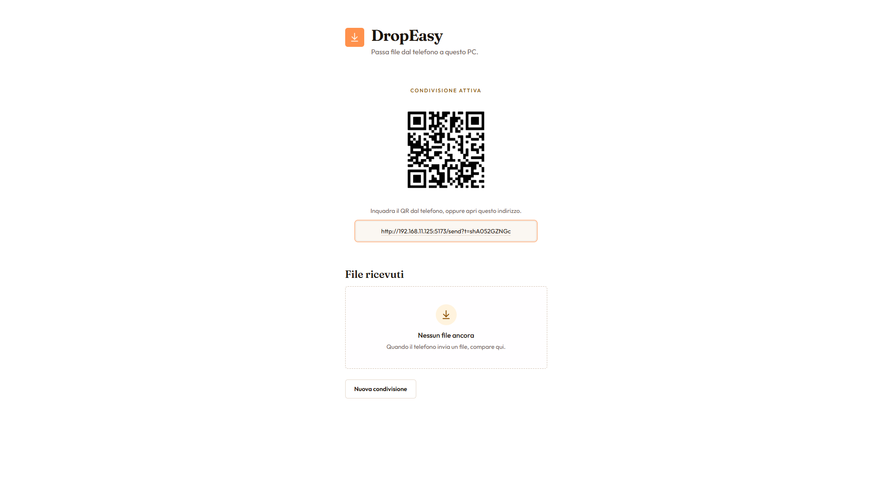

# DropEasy

Passa file dal telefono a questo PC. Dal computer avvii una condivisione, inquadri il QR con il telefono e invii i file: compaiono nel pannello e li scarichi in locale.

## Funzionalità

- Avvio di una sessione di condivisione dal PC, protetta da un token
- QR code e link da aprire sul telefono, sulla stessa rete
- Invio di uno o più file dal telefono, con avanzamento
- Elenco dei file ricevuti e download sul PC
- Nuova condivisione, che sostituisce il token precedente

## Tecnologie utilizzate

- React, Vite, Tailwind CSS
- Python, FastAPI, Uvicorn
- qrcode
- File temporanei in locale; Vercel Blob quando l’app è deployata


## Installazione

```bash
git clone https://github.com/simone-2006/dropeasy.git
cd dropeasy
npm install
cd frontend
npm install
cd ../server
pip install -r requirements.txt
```

Python 3.13.

## Avvio

```bash
npm start
```

Il pannello è su [http://localhost:5173](http://localhost:5173). Il server ascolta sulla porta 8000.

## Deploy su Vercel

1. Collega un Blob store al progetto (`BLOB_READ_WRITE_TOKEN`).
2. Imposta la variabile d’ambiente `PANEL_SECRET` (stringa lunga e casuale, es. output di `python -c "import secrets; print(secrets.token_urlsafe(32))"`).
3. Opzionale: `MAX_UPLOAD_BYTES` (default 50 MB).
4. Apri una volta `https://tuodominio/?k=VALORE_DI_PANEL_SECRET`: il sito salva un cookie e puoi bookmarkare la home senza `k` nella barra.

La pagina telefono `/send?t=…` e l’upload restano protetti solo dal token di sessione, senza cookie del pannello.

## Screenshot



## Autore

**Simone Penza**

[GitHub](https://github.com/simone-2006)